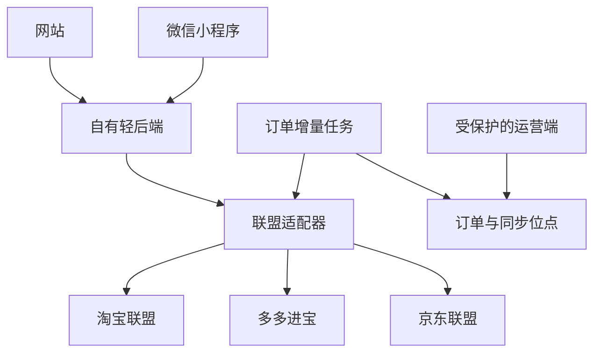

# 券省产品与接入方案

版本：0.1 / 2026-10-29。用途：确认产品与技术范围，作为下一步联盟接入的开发交接。

## 1. 业务模式先对齐

按当前需求，平台提供优惠导购：用户查券后回淘宝、京东或拼多多下单，运营方从符合联盟规则的有效订单中获得推广佣金。用户获得的是可使用的优惠券，不默认承诺再向用户返现金。

如果后续需要“佣金的一部分返给用户”，则会增加账号、用户级订单归因、返现规则、余额明细、提现与退款冲正等功能，两个 Tab 的界面依然可以保留，但底层业务复杂度会明显增加。

名称统一为：淘宝联盟、多多进宝、京东联盟。佣金来自有效推广，优惠券来自相应商品或活动；“专享券”只有在接口及业务权限确实提供专享权益时才能对外这样宣传。

## 2. 为什么需要轻后端

前端负责展示与交互，服务端负责联盟访问及订单处理。即使不自建庞大的业务系统，也应有一个小型服务端或云函数层。

| 需求 | 放置位置 | 原因 |
| --- | --- | --- |
| 商品展示、关键词、平台和专题筛选 | 网页 / 小程序 | 不涉及密钥 |
| 签名、App Secret、授权令牌、推广位配置 | 服务端 | 密钥放进浏览器或小程序包会被提取 |
| 转链及优惠查询 | 服务端联盟适配器 | 平台请求和返回结构不同，需统一处理 |
| 商品短期缓存、超时、限流 | 服务端 | 降低接口消耗，避免同一查询反复调用 |
| 订单归因、退款更新、结算核对 | 定时任务 + 数据库 | 用户关闭页面后也必须继续同步 |
| 运营方佣金与订单信息 | 有鉴权的运营端 | 不向普通访客暴露推广收入及订单数据 |

若第一阶段只导购、运营方手工去联盟后台看佣金，可以暂不自建订单库；若要求系统自动识别订单并持续显示佣金状态，就需要保存同步位点、订单状态与核对数据。数据库可以从 SQLite 或托管数据库起步，无须先搭复杂中台。

## 3. 最小架构



客户端不能直接访问联盟密钥；跨站 CORS 转发不是安全后端的替代品。

## 4. 两个 Tab 的产品结构

| 入口 | 内容和行为 |
| --- | --- |
| 首页 | 查券搜索框、三平台入口、日用 / 居家 / 数码专题、券后价、优惠券、商品预览与购买入口 |
| 转链 | 粘贴分享文案、识别平台、商品与优惠查询、创建推广链接、明确的领券购买方式、最近记录 |

首页点击商品也必须走已绑定本平台推广位的链路。不能直接把联盟商品源链接当成最终购买链接；可按访问场景实时生成，或缓存合法、未过期、符合归因要求的推广内容。

访客只领券时可以不强制登录。若需要用户级归因，应登录后使用服务端可信身份，不能让前端任意提交一个 `userId` 决定订单归属。

## 5. 转链过程

1. 接收单个商品链接或分享文案，限制长度，剔除包裹标点。多个不同链接时要求用户选择。
2. 根据官方域名或合法口令识别平台。短链优先通过平台批准的解析能力处理，不能由服务端无约束地抓取用户给出的任意 URL。
3. 查询实际商品信息、推广资格和当前优惠。无法查询时返回明确状态，不捏造优惠。
4. 在服务端使用已登记的推广位及该账号获准的归因参数调用转链。
5. 保存必要的追踪引用和生成时间，向客户端返回平台允许使用的推广内容。
6. 用户领取可用优惠后，在原购物平台下单。下单不保证一定产生佣金；跟踪、商品资格、退款等均影响最终结算。

转链不等于“购买任意商品都返佣”。原分享链接携带的其他推广信息应通过官方接口转换，不能简单在 URL 后面拼接一个自己的 PID。

## 6. 官方接入核实与限制

以下基于本次能检索到的官方资料，具体可调用权限、费率、额度、字段和规则，以账户控制台及上线前文档为准。“不需要用户授权”不等于不需要开发者应用和接口权限。

| 平台 | 本次核实或待核实内容 |
| --- | --- |
| 淘宝联盟 | 官方列出物料搜索升级版、万能转链 `taobao.tbk.dg.general.link.convert`、淘口令解析 `taobao.tbk.tpwd.parse` 和订单明细 `taobao.tbk.order.details.get`。按账号权限选用，不保证所有参数可用。 |
| 京东联盟 | 官方列出商品与优惠查询、`jd.union.open.promotion.common.get`，并说明部分用户标识参数要申请权限。旧订单查询页面提示迁移到订单行查询文档 12707，接入时核对当前控制台版本。 |
| 多多进宝 | 本次公开检索未成功读取完整官方参数页。需使用实际应用控制台确认商品查询、转链、订单增量以及是否属于 OAuth 工具商接口；不以第三方旧示例代替确认。 |

第一步应分别检查账号是否真正能调用“商品、转链、订单”三类能力，再决定先上线哪一家。不要在尚无接口权限时假设三家只需填几个密钥就能全量打通。

## 7. 归因的三个层次

| 层次 | 能回答的问题 | 所需条件 |
| --- | --- | --- |
| 平台级 | 这个订单是否归属我们这个联盟媒体或推广位？ | 合法媒体、推广位及平台归因规则 |
| 渠道级 | 订单来自哪个网站专题、渠道或推广位？ | 受支持的渠道 / 推广位配置 |
| 用户级 | 是网站里的哪个用户下的订单？ | 自有可信用户身份 + 平台允许并返回的用户 / 渠道标识 |

不能因为多个用户点击同一个 PID，就认为订单查询会自动返回各自微信身份。淘宝的渠道或会员关系、京东的子渠道字段、多多进宝的可用自定义标识，均需按对应权限与文档核实，不能统一假设都能任意传一个 UID。

当前演示不收集用户身份，不建立用户级订单归因，也不返回任何真实订单数据。

## 8. 订单同步与佣金

订单在联盟侧通常经历付款、收货、结算、失效或退款等变化。产品需要分别展示预估与已结算金额，映射平台原始状态并保留原始状态码；未知码记为 `unknown`，不能默认算已结算。

最低设计要求：

- 按平台规定的时间窗口及频率，以更新时间增量分页同步；同步位点只有在窗口全部写入成功后才前进。
- 使用少量重叠时间窗口和幂等写入应对延迟更新；另有退款或维权接口时独立补偿，不假设正向订单接口包含所有售后变化。
- 订单或订单行按平台原始主键去重，旧数据不能覆盖更新的数据；佣金金额用整数分或精确定点数。
- 佣金比例按各接口单位归一化，不能混用百分比、千分比；同时保存接口的原始费率文本便于核对。
- 以联盟返回的结算字段及实际报表为准，不能简单把券后价乘一个预设比例当作最终收入。技术服务费、退款等也可能影响收入。
- 先做有鉴权的运营方订单列表：平台、订单号、归因范围、商品、预估佣金、结算佣金、状态、更新时间。暂不需要用户提现功能。

`server/schema.sql` 给出三张表的草案：`conversions`、`affiliate_orders`、`sync_checkpoints`。本次未实现数据库读写或定时同步。

## 9. 微信小程序跳转

网页外链与微信小程序跳转是两套能力。不能把一个商品 H5 URL 直接当作 `wx.navigateToMiniProgram` 的 `path`。

正式版按平台授权返回以下一种或多种方式：

- 目标小程序真实的 `appId`、推广页面 `path`，以及必要、受支持的附加参数。
- 平台允许的推广口令或链接，提示复制后在相应购物 App 打开。
- 符合微信与联盟当前规则的其他正式入口。

前端先异步完成转链并展示结果，再让用户点击购买按钮；在该点击处理函数中同步调用跳转。跳转失败应展示可用的替代方式，不能提示“下单成功”。

本工程未提交小程序审核。正式上线还要按自身主体及实际类目核实审核材料、隐私声明、请求与图片合法域名、域名备案等要求；当前未验证任意主体都能获得跨平台推广资格。

## 10. 接口契约

当前可运行的接口全部是 demo：

| 接口 | 现状 |
| --- | --- |
| `GET /api/health` | 返回 `mode: demo` 与三家未接入状态 |
| `GET /api/products` | 返回样例，支持 `platform / category / query / sort` |
| `POST /api/convert` | 接收 `{text}`；示例返回演示商品，其他受支持链接只返回识别平台；`promotion` 永远为 `null` |

待实现的正式适配器在内部统一为：

```ts
type Promotion = {
  webUrl?: string;         // 只接收来自验证过的官方响应的 HTTPS 推广链接
  copyText?: string;       // 可复制的合法推广内容或口令
  miniProgram?: { appId: string; path: string };
  expiresAt?: string;      // 只有上游确实提供有效期时才返回
};

type ConvertResult = {
  mode: 'live';
  platform: 'taobao' | 'pdd' | 'jd';
  status: 'READY' | 'NO_COUPON' | 'NOT_PROMOTABLE';
  product: {
    id: string;
    title: string;
    platform: string;
    sourceUrl: string;
    imageUrl: string;
    priceFen: number;
    couponFen: number;
  } | null;
  promotion: Promotion | null;
};
```

无券和不能推广是两个不同状态：无券但可推广时，不显示“券后价”或领券承诺，可展示正常推广入口。券有门槛、仅限部分 SKU 或特定用户时，应展示限制；不能直接做全商品统一减券计算。当前样例都是简单的无门槛优惠展示，尚未实现正式价格规则与受限优惠渲染。

正式适配器需另行补齐请求签名、凭据管理、超时、平台错误转换、限流及缓存。运营订单接口单独鉴权，禁止把 App Secret 或完整联盟响应直接交给客户端。

## 11. 下一步顺序

1. 用原型确认“平台赚佣金、用户只领券”的模式及双 Tab 页面。
2. 核实三个账户的接入权限，选择一家完成真实商品查询 → 转链 → 人工验证有效订单归因。
3. 用自己的微信 AppID 做一次领券、跳转、下单路径的真机验证；网页和微信分别验收。
4. 补订单增量、退款处理、运营端和最小持久化，再接第二、第三家。
5. 对比自有统计与联盟实际结算，达成一致后再决定是否扩展用户返现。

完成当前原型不代表上述步骤已完成。没有进行真实领券、真实下单、联盟签名调用、佣金结算或微信真机验收。

## 12. 官方参考

- 淘宝物料搜索升级版：https://developer.alibaba.com/docs/api.htm?apiId=64759
- 淘宝万能转链：https://developer.alibaba.com/docs/api.htm?apiId=65409
- 淘口令解析：https://developer.alibaba.com/doc2/apiDetail.htm?apiId=42646
- 淘宝订单明细：https://developer.alibaba.com/doc2/apiDetail.htm?apiId=43328
- 京东联盟 API 列表：https://jos.jd.com/apilist?apiGroupId=531&apiGroupName=京东联盟api&apiId=17769&apiName=jd.union.open.selling.goods.query
- 京东订单行文档：https://union.jd.com/openplatform/api/12707
- 多多进宝官方入口：https://jinbao.pinduoduo.com/ （本次未取得完整官方参数页，需登录应用控制台核对）
- 微信跳转 API：https://developers.weixin.qq.com/miniprogram/dev/api/navigate/wx.navigateToMiniProgram.html （本次未完整读取此文档）
- 腾讯官方小程序跳转示例：https://qian.tencent.com/developers/partner/openwxminiprogram/
