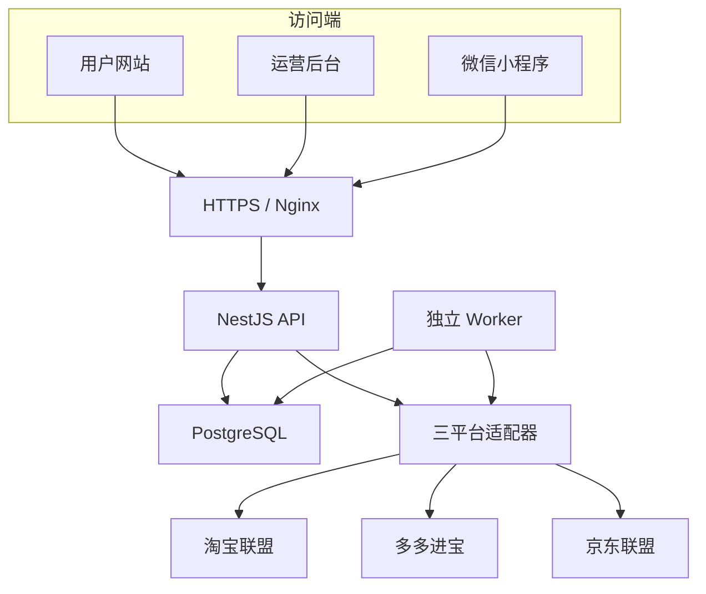
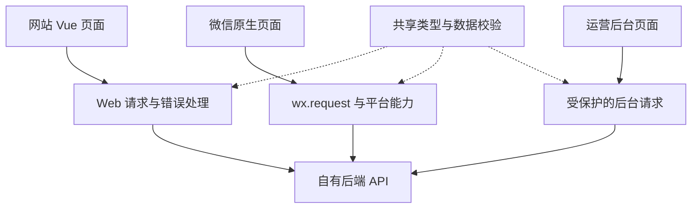
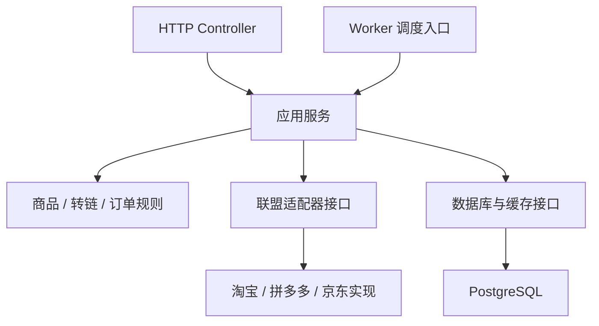
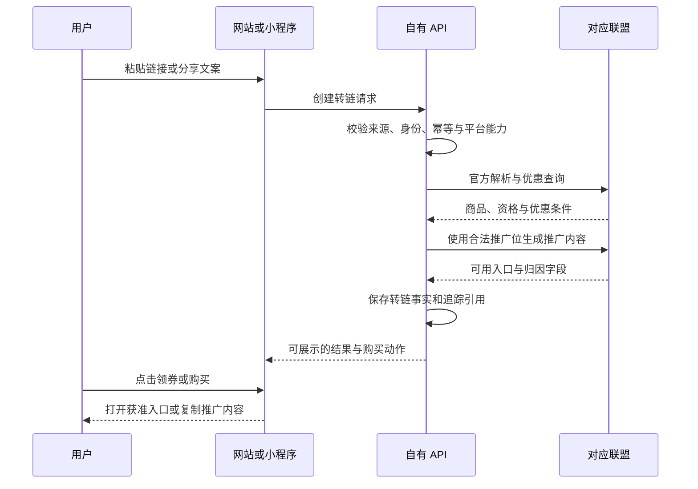

# 券省：网站与微信小程序前后端开发方案

版本 V1.2｜日期 2026-11-11｜前后端开发设计与实施计划

目标是建设接入淘宝联盟、多多进宝、京东联盟的优惠导购平台，支持商品精选、优惠查询、推广转链、订单和佣金核对，并在权限获批后开放用户推广收益与提现。

## 1. 业务范围与当前基础

### 1.1 本期业务模式

导购阶段由用户领券并回原购物平台购买，券省按联盟规则获得有效推广订单的佣金。用户推广阶段由登录用户分享专属推广入口，在联盟订单能归到该推广者时，券省按结算结果支付其应得份额。

- 用户不在本平台付款，本平台不负责商品履约、发货和商品售后。
- 用户推广收益来自直接归因给该用户的有效订单，分佣、提现和退款调整按第 17 节实施。
- 用户端保留“首页、转链”两个 Tab；运营端单独建设后台。
- 只有联盟实际返回专属权益时才显示“专享券”；普通优惠券不包装成专享权益。
- 无券与不能推广分开处理：商品无券也可能可推广；商品有券也不代表当前媒体可以获得佣金。

先验证导购、转链和订单同步，再开放用户推广收益。推广结算以联盟实际确认的订单佣金为基础。

### 1.2 当前原型与目标系统的差距

已核对现有原型页面、源码包 README 和演示服务代码。

| 项目 | 当前原型 | 本方案目标 |
| --- | --- | --- |
| 网站 | 静态网页，样例商品与本机记录 | 响应式网站，经自有后端读取联盟商品数据 |
| 小程序 | 微信原生双 Tab 起步工程 | 自有 AppID 下可审核、可真机使用的正式版本 |
| 服务端 | Node 演示接口；正式模式明确拒绝启动 | NestJS 业务服务与三平台真实适配器 |
| 商品与优惠 | 内置样例，真实链接只识别平台 | 联盟查询、统一商品模型、优惠资格与有效期展示 |
| 推广转链 | 不生成真实推广内容 | 服务端绑定推广位并返回合法购买入口 |
| 订单与佣金 | 未实现真实查询或结算 | 增量同步、退款更新、预估与结算分开统计 |
| 数据与运营 | 数据表草案，无数据库读写 | PostgreSQL 持久化、运营后台与任务状态 |

现有视觉设计、交互流程、原生小程序基础和部分链接识别测试可以复用。现有演示接口不是正式后端，不能通过填写密钥直接上线营业。

### 1.3 订单归因分层

| 归因层次 | 能确认什么 | 产品安排 |
| --- | --- | --- |
| 平台级 | 订单归属我们的联盟账号或推广位 | V1 基础目标 |
| 渠道级 | 来自网站、小程序、某个专题或推广位 | 对应平台能力开通后启用 |
| 用户级 | 联盟订单可归到哪个可信登录推广者 | 用户分佣的前置能力，按联盟账号与媒体逐一验证 |

下单平台不会因为用户曾登录我们的微信小程序，就自动返回该用户的微信身份。同一个 PID 也不等于可以区分每个用户。无法获得明确归因证据时，标记“未匹配”或仅记录平台级归属，不按最近点击时间猜测用户。

## 2. 技术选型

### 2.1 推荐方案

采用“模块化单体后端 + 独立 API / Worker 进程 + 一个关系数据库”，适合个人或小团队渐进开发。API 与 Worker 共用同一套领域逻辑和联盟适配器，不拆成多个独立业务系统。

| 层次 | 推荐技术 | 用途及选择理由 |
| --- | --- | --- |
| 用户网站 | Vue 3、TypeScript、Vite、Vue Router | 响应式页面、路由与组件开发 |
| 网站状态 | 页面查询状态为主，Pinia 按需使用 | 避免把所有接口响应长期保存在全局状态 |
| 微信小程序 | 继续原生 WXML、WXSS、JS；按工程需要引入 TS | 复用现有工程，直接处理微信登录、剪贴板和跳转 |
| 运营后台 | Vue 3、TypeScript、Element Plus | 配置、表格、筛选、订单核对和任务诊断 |
| 后端 API | NestJS、TypeScript | 模块组织、请求校验、权限控制、OpenAPI |
| 后台任务 | 独立 NestJS Worker，应用调度 + 数据库任务记录 | 订单同步、售后补偿和对账 |
| 数据库 | PostgreSQL + Prisma | 持久化、迁移、事务、唯一约束与精确金额 |
| 缓存 | 初期进程内短缓存；需要跨实例时接 Redis | 初期不强制多引入一个基础设施 |
| 部署 | Nginx、Docker Compose | 静态文件、HTTPS、反向代理、API / Worker / DB 运行 |
| 合同与文档 | OpenAPI + 共享 TypeScript 类型 | 降低网站、小程序与后端字段不一致的问题 |

Vue 官方支持 TypeScript 与 Vite 工程；NestJS 的模块机制适合按功能组织业务。[S1][S2] 具体运行时和依赖版本在建正式工程时统一验证、锁定，不混用不同主版本的 ORM 示例代码。

### 2.2 为什么保留原生小程序

目前只要求微信一个小程序端，且已有原生双 Tab 起步工程，迁移跨端框架并不能直接解决联盟权限或跳转问题。网页和小程序共享数据契约、格式化规则及部分纯业务函数，分别实现 UI 和平台 API。

后续确有支付宝、抖音等小程序需求，再评估 uni-app 或 Taro；当前不为尚未确定的多端需求重写已有原生界面。

### 2.3 首版不引入的架构

首版采用模块化单体。首页和搜索从联盟接口按需取商品，按平台规则做短缓存。后台选品、专题管理、商品快照和商品刷新任务随实际运营需求启用。Redis、任务队列和搜索索引随多实例限流、任务积压或自有搜索需求增加。

## 3. 总体架构



所有客户端通过自有 HTTPS API 访问业务能力，不持有联盟 App Secret。API 接待前台请求，Worker 在用户离线后继续同步订单。正式数据库、凭据和任务状态不依赖演示网页托管环境。

部署上可以先放在同一台服务器，但 API 与 Worker 使用不同进程和启动命令。Worker 批处理故障不能把查券接口一起阻塞；未来可独立扩容。

## 4. 前端架构与页面设计

### 4.1 前端分层



共享包只包含类型、常量、金额格式化与可移植的校验规则。Web 使用浏览器请求适配层，小程序使用 `wx.request`；不把依赖 DOM、Node 内置模块或联盟密钥的代码打进小程序包。

### 4.2 用户网站

| 页面 | 主要内容 | 与后端交互 |
| --- | --- | --- |
| 首页 `/` | 搜索框、平台入口、联盟精选商品 | 从 `GET /api/v1/products` 获取当前平台的商品列表，专题配置按需启用 |
| 搜索 `/search` | 关键词、平台、分类、排序、分页 | 商品搜索；链接输入改走转链接口 |
| 转链 `/convert` | 链接 / 分享文案、平台识别、查询进度、优惠结果 | 创建转链结果、读取结果 |
| 商品预览 | 图片、平台、价格口径、优惠规则、购买方式 | 商品详情；购买前生成或刷新推广内容 |
| 使用说明 | 领券步骤、付款售后说明、价格口径 | 内容可配置，初期可静态维护 |

首页点击“领券购买”和用户粘贴链接，最终进入同一个转链业务服务，避免首页绕开推广位绑定。

价格展示必须按接口事实区分“当前价”“预计到手价”“指定 SKU 价”与“满足条件可减”。优惠适用性未知时不做简单减法，也不使用“全网最低”“每件都有券”等无法证实的表达。

### 4.3 微信小程序

| Tab | 内容 | 交互要求 |
| --- | --- | --- |
| 首页 | 精选商品、专题、平台筛选、搜索 | 点击商品后查询对应商品并准备购买入口 |
| 转链 | 粘贴分享文案、识别、查券、生成结果、最近记录 | 先展示结果，再由用户点击发起跳转或复制 |

开放用户推广后，从首页或转链结果页进入推广中心。推广中心展示专属分享入口、推广订单、收益明细和提现记录。

小程序特有处理：

- 只在用户点击“粘贴”时读取剪贴板，不在首页打开时自动读取。
- 对同一输入中的多个不同商品链接给出选择提示；同链接重复出现可以去重。
- 每次输入变更都使上一次未完成请求的结果失效，防止旧响应覆盖新输入。
- 跳转数据来自真实接口和服务端验证，不拼凑目标小程序路径。
- 先完成异步转链，再展示“去购买”按钮；用户点击时同步调用微信跳转能力。腾讯官方示例也明确了这种用户手势要求。[S3]
- 不具备小程序直达条件时，只使用平台允许的复制口令或推广内容方式，并提示用户到对应 App 打开。
- 跳转成功只代表成功打开入口，不代表领券、下单或佣金归因成功。

### 4.4 运营后台

| 模块 | 页面能力 |
| --- | --- |
| 经营概览 | 推广订单数、预估佣金、联盟结算佣金、最后同步时间 |
| 平台接入 | 账户、媒体、推广位、权限能力、授权状态、最近调用错误 |
| 首页与专题（按需） | Banner、自定义专题排序与生效时间 |
| 商品运营（按需） | 人工精选商品维护、优惠状态、失效商品下架 |
| 转链记录 | 平台、来源渠道、结果状态、错误分类、追踪引用 |
| 推广订单 | 平台与时间筛选、订单行、归因范围、佣金、退款状态 |
| 同步任务 | 运行情况、滞后、失败页、重试与限定时间补拉 |
| 操作审计 | 记录谁调整了专题、推广位或任务配置 |

后台按 `viewer / operator / admin` 设置简单固定权限。密钥字段只显示是否已配置与脱敏指纹，不提供明文回显或浏览器导出。

### 4.5 客户端状态约定

| 状态 | 客户端展示 |
| --- | --- |
| 初始 | 输入或粘贴链接 |
| 查询中 | 禁止重复提交，展示有限时长的加载反馈 |
| 有可用优惠 | 展示优惠条件与对应购买入口 |
| 无优惠但可推广 | 展示普通推广购买入口，不承诺领券 |
| 不能推广 | 明确说明本平台暂不能为该商品生成推广入口 |
| 资格不确定 | 显示条件价或优惠条件，要求在平台确认，不宣称必得 |
| 上游超时 / 限流 | 可重试提示，不转换成“商品不存在” |
| 应用权限缺失 | 显示该平台暂未开放，并在后台提示具体缺失能力 |
| 演示模式 | 持续显示示例标识，不能渲染为真实推广成功 |

## 5. 后端架构

### 5.1 应用内部结构



Controller 负责请求、身份和返回格式；应用服务编排流程；平台差异集中在适配器。订单数据库结构和上游原始返回都不能直接当作面向客户端的 DTO。

### 5.2 模块划分

| 模块 | 职责 | 对外边界 |
| --- | --- | --- |
| AuthModule | 运营人员登录、会话、权限；后续可选微信身份 | 不把前端提交的 userId 当可信身份 |
| HomeModule | 首页、Banner、专题配置 | 管理配置与展示配置分开 |
| CatalogModule | 商品搜索、详情、类目映射、列表缓存 | 不负责生成购买归因参数 |
| ConversionModule | 输入识别、推广位选择、幂等、转链结果 | 前台购买入口的唯一编排服务 |
| AffiliateModule | 平台账号、能力检查、三套适配器、签名与授权 | 只在服务端运行 |
| TrackingModule | 可信来源、追踪引用、渠道 / 用户关系映射 | 不能保证上游未提供的归因粒度 |
| OrderModule | 订单行归一化、状态更新、佣金快照 | 仅提供受保护的运营接口 |
| SyncModule | 增量窗口、分页、重试、退款流、任务锁 | 仅 Worker 与内部运维入口使用 |
| ReportingModule | 预估、结算和调整统计、对账差异 | 不把统计字段命名成用户余额 |
| AuditModule | 配置变更、人工补拉与关键管理操作审计 | 记录脱敏事实，不记录明文密钥 |

这不是十个微服务，而是同一后端工程中的功能模块。

### 5.3 平台适配器契约

以下为自有业务接口设计，不是任何联盟的真实 HTTP 参数：

```ts
type Platform = 'taobao' | 'pdd' | 'jd';
type Client = 'web' | 'wechat';

interface AffiliateAdapter {
  capabilities(accountId: string): Promise<PlatformCapabilities>;
  resolve(input: ResolveInput): Promise<ResolvedProduct>;
  search(input: SearchInput): Promise<ProductPage>;
  detail(input: ProductIdentity): Promise<ProductSnapshot>;
  createPromotion(input: PromotionInput): Promise<PromotionResult>;
  pullOrders(input: OrderSyncWindow): Promise<SourceOrderPage>;
  pullAfterSales?(input: OrderSyncWindow): Promise<SourceAfterSalePage>;
}
```

`ProductIdentity` 使用平台原生有效标识，可以是加密字符串或其他上游标识，不统一强转成数字商品 ID。平台接口没有支持的能力就不实现该方法，使用能力检查明确返回不支持。

`PlatformCapabilities` 至少包含商品查询、关键词搜索、转链、订单、售后、渠道归因、用户归因，以及对不同客户端可用的购买入口。应用能调用商品搜索，不能推定它也能查询订单。

### 5.4 三平台接入安排

| 平台 | 需实现的能力 | 当前官方证据与实施边界 |
| --- | --- | --- |
| 淘宝联盟 | 商品与优惠、口令 / 链接解析、转链、订单与售后 | 官方列出万能转链、应用参数和签名；订单明细支持按不同时间口径查询。[S4][S5] 具体媒体、权限、归因字段和接口版本须按账号验证。 |
| 京东联盟 | 商品与优惠、推广内容、订单行与更新 | 官方描述了转链及部分用户标识参数的权限要求；旧订单页面提示迁移到订单行接口文档 12707。[S6][S7] 不以旧接口示例作为最终实现。 |
| 多多进宝 | 商品标识解析、优惠、转链、订单增量及可用售后流 | 当前完整官方参数页未成功取得，不写死网上旧版 DDK / OAuth 参数。先在实际应用控制台确认自推广或工具商角色及当前接口。 |

每家接入前保存“控制台权限截图 / 文档版本 / 脱敏成功响应 / 错误码样例 / 字段映射”作为开发证据。OAuth 授权与刷新逻辑只对确实需要它的应用实现，不能把商家接口、工具商接口和推广者接口混用。

### 5.5 上游调用策略

- 网关地址在服务端固定配置；用户输入只传给已批准的官方解析 / 转链接口，不变成任意地址的服务器抓取请求。
- 平台超时、限流、权限失效、商品失效分别映射为内部错误码。
- 每个平台分别设置并发和配额，不让一家平台的失败拖死其他查询。
- 查询和同步可按错误类型有限重试；转链结果不确定时，先检查是否已有可复用结果，避免无上限重复调用。
- 凭据刷新采用账号级互斥，刷新完成后原子保存令牌版本；原始密钥不进入访问日志。
- 生产环境不在真实调用失败后退回样例数据；演示与正式模式从数据源到界面全程可辨认。

## 6. 核心业务流程

### 6.1 首页推荐商品

商品标题、图片、价格、优惠条件和商品标识以淘宝联盟、多多进宝、京东联盟的返回为准。首版首页直接使用获准的联盟推荐、榜单或可推广商品查询能力。

| 商品来源 | 首页与搜索的取数方式 |
| --- | --- |
| 淘宝联盟 | 官方物料精选升级版提供指定物料的商品及推广入口。关键词搜索使用对应应用角色获准的物料搜索接口。[S11][S12] |
| 多多进宝 | 官方资料列有推荐、榜单和商品查询能力。当前可用接口、参数和推广位要求在应用控制台核实。[S13] |
| 京东联盟 | 商品及优惠券查询支持关键词、SKU 等条件。首页按获准的选品场景取货，正式接入从京东联盟开放平台开始。[S6][S14] |

首页请求 `GET /api/v1/products?platform=taobao&feed=recommended`。后端调用对应联盟并完成签名，把需要展示的字段整理后返回。比如商品卡片只取平台、商品引用、标题、主图、价格和已知优惠信息。淘宝开放平台的签名使用应用密钥，密钥保存在服务端。[S15]

首版按当前选中的平台分页加载，切换平台时查询对应联盟。联盟允许的商品数据可以短期缓存。人工专题和精选快照按需启用，首版只需按官方选品场景配置首页。商品列表和搜索结果可以直接来自本次查询或缓存，商品引用由平台和上游标识生成。

购买时核验当前商品、优惠和客户端可用入口。联盟商品接口已经返回符合当前推广位与渠道的有效推广内容时可以复用，其余情况通过联盟接口生成推广内容。商品失效时更新展示并说明原因。

### 6.2 用户输入关键词

用户选择单个平台时，后端查询该平台的联盟搜索接口。首版优先做平台内搜索。需要“全部平台”时，再并行请求已开通的联盟，把结果按平台展示。

如增加跨平台排序，价格排序只针对已取得且口径可比较的候选。资格不明或只能展示条件价时，保留各平台的价格说明。

分页游标保存或签名校验对应平台的位点和查询条件。“全部平台”返回各家独立结果与 `platformStatus`，用户可以看到哪家暂时查不到。

### 6.3 用户转链



这里没有“前端下单成功通知后端”的步骤。真实订单是否归属本平台，由后续联盟订单数据核实。

为保证故障可追踪，调用上游前先创建 `conversion_request`。转链成功但响应丢失时，重试用同一个幂等键读取已有结果；上游成功、数据库保存失败时不报告完整成功，记录可核对错误和上游请求引用后由补偿任务处理。

### 6.4 幂等与推广内容缓存

- 幂等范围至少包括请求主体、输入摘要、目标平台、媒体推广位、客户端、可用归因范围和请求键。
- 同一请求键换了输入，返回冲突，不复用旧商品结果。
- 个性化优惠、用户关系标识或独立追踪内容不能跨用户复用。
- 不同媒体或网站 / 小程序推广位不能共享带归因的缓存。
- 不把自有缓存时间包装成联盟认可的有效期；`upstreamExpiresAt` 与自有 `refreshAfter` 分开记录。
- 临近失效或权限版本变化时重新转换。尚未返回有效期的入口采用保守刷新，实际规则由适配器配置。

## 7. 数据模型

### 7.1 持久化范围

首版持久化运营配置、转链事实、追踪关系、联盟订单和同步状态。首页和搜索按需查联盟，商品卡片可以直接使用上游返回。运营需要人工选品或保存历史商品信息时，再增加精选商品引用或快照，字段与留存方式遵循联盟权限。

### 7.2 核心表

| 表 | 关键字段 | 约束或用途 |
| --- | --- | --- |
| `admin_users` | id、登录名、密码散列 / SSO 引用、角色、状态 | 登录名唯一；没有默认生产密码 |
| `affiliate_accounts` | platform、应用引用、secret_ref、角色、能力、授权状态、配置版本 | 数据库只保存密钥引用或受保护的加密令牌，不明文存储 App Secret |
| `promotion_slots` | account_id、媒体引用、上游推广位、渠道、客户端、启用状态 | 同一账号内推广位标识唯一；区分 Web 与微信可用性 |
| `collections`（按需） | 标题、平台筛选、封面、排序、有效期、状态 | 自定义专题启用时使用 |
| `collection_items`（按需） | collection_id、平台商品引用、排序、状态 | 人工选品启用时使用 |
| `product_snapshots`（按需） | 平台原生商品标识、标题、图片、价格、优惠规则、查询时间、过期时间 | 有明确快照用途且联盟允许留存时使用 |
| `conversion_requests` | id、幂等键、请求主体引用、输入摘要、平台、状态、错误码、创建时间 | 记录调用前状态；输入原文按需要短期加密保存或不保存 |
| `promotion_results` | request_id、推广位、追踪引用、允许的购买动作、生成时间、上游有效期、刷新时间 | 不向客户端暴露凭据或上游完整响应 |
| `tracking_bindings` | account_id、归因范围、上游关联标识、可信主体 / 渠道引用 | 已批准的可逆查找关系；不直接把手机号或 OpenID 拼进链接 |
| `affiliate_order_lines` | account_id、源记录键、订单号、明细号、归因、金额、状态、源更新时间 | 对账号 + 源记录键唯一，作为订单当前快照 |
| `order_change_events` | 订单行引用、源事件键 / 变更摘要、前后状态与金额、记录时间 | 追踪结算后退款、修正、重放；事件幂等 |
| `sync_runs` | 账号、数据流、固定窗口、分页位点、状态、重试、租约、最近错误 | 持久化执行状态，不依赖内存计划 |
| `sync_checkpoints` | 账号、数据流、已完成高水位、版本 | 只有完整窗口成功才能前进 |
| `audit_logs` | 操作人员、动作、对象、脱敏变更、时间 | 管理与人工补偿审计 |

用户推广阶段启用 `users` 和 `user_identities`，管理可信登录、绑定和授权。推广者归因复用 `tracking_bindings`，收益与提现表见第 17 节。

### 7.3 金额、ID 与时间规范

- 上游订单 ID、商品标识、推广位均按字符串处理，避免超出 JavaScript 安全整数范围或破坏加密标识。
- 商品价格若源精度为分，内部使用整数分；源精度更高时保留精确十进制值，不能先用浮点数再四舍五入。
- 佣金与调整金额用 PostgreSQL `NUMERIC` 保存精确元值，建议预留 6 位小数；若具体接口需要更高精度则扩展。JSON 用十进制字符串返回，展示层最后统一格式化。
- 费率统一成乘数口径，例如 12.5% 保存为 `0.125`；同时保留 `raw_value + raw_unit`。单位未确定时不进行推算。
- 服务端内部时间统一 UTC，展示用 Asia/Shanghai；平台请求按它要求的时区编码。业务日与结算周期必须明确口径。
- 保留 `source_updated_at`、`fetched_at`，必要时加上源版本或快照摘要；“本机刚同步”不能当成“源数据一定更新”。

### 7.4 订单去重规则

优先使用平台提供的稳定订单行 / 记录主键。`source_record_key` 由适配器在文档确认后构造，唯一约束为 `(affiliate_account_id, source_record_key)`。

不能仅用商品 ID、金额、时间或订单号拼出看似唯一的订单行。同一订单可能有多行、拆分或调整。若上游只提供订单级数据，就按订单级事实保存，不伪造订单行；接口接入验收必须确认这点。

## 8. 订单同步、退款与统计

### 8.1 状态分开建模

| 维度 | 内部示例值 | 说明 |
| --- | --- | --- |
| 交易状态 | paid、received、cancelled、refunded、unknown | 商品交易发生了什么 |
| 佣金状态 | estimated、settled、invalid、adjusted、unknown | 佣金当前处于什么口径 |
| 售后状态 | none、partial、full、processing、unknown | 是否存在退款 / 售后 |
| 归因范围 | platform、channel、user、unmatched | 有多少归属证据 |

以上为自有枚举，不是三家联盟的状态码。适配器保存原始状态并按版本映射；遇到新码进入 `unknown` 并告警，不默认当作结算成功，也不强行要求所有状态单向前进。

### 8.2 增量同步算法

1. 按联盟账号和数据流领取任务租约，避免多个实例重复推进同一位点。租约包含所有者、过期时间和递增版本；Worker 续租失败后停止推进，旧实例写位点必须因版本不匹配而失败。
2. 读取已完成位点，结合安全延迟和重叠范围，确定一个固定查询窗口。窗口大小、轮询频率和最大追溯时间按对应平台当前文档及额度配置，不把任意频率当官方承诺。
3. 按平台规定的分页或游标获取该窗口的数据。网络调用不放在长数据库事务内。
4. 每页用短事务幂等写入快照、变化事件与当前运行页位点。更旧的源版本不能覆盖更新版本；源时间相同但内容变化时按适配器规则补查，不靠本机到达顺序决定。
5. 某页失败，保留固定窗口与重试状态；分页位点失效时重跑同一窗口，利用唯一键避免重复记账。
6. 只有所有页及需要的分区处理成功，才在事务中按版本比较推进已完成高水位。
7. 正向订单、维权 / 退款、平台处罚或结算报表等若为不同接口，使用独立的数据流和位点，分别合并事实，不让旧正向快照覆盖更新的售后结果。
8. 定期做允许范围内的回补和结算核对，记录差异，不静默修成“系统对得上”的数字。人工回补和历史对账使用独立运行记录，不推进或回退实时增量流的主位点。

NestJS 可提供调度入口，持久化运行记录和并发控制由本系统承担。[S8] PostgreSQL 提供事务和锁机制，可支撑相应的协调设计。[S9] 初期不把“定时函数运行过”当作“整段订单已经同步完成”。

### 8.3 佣金展示口径

- **预估佣金**：符合查询条件、尚待最终结算的联盟预估值。
- **联盟结算佣金**：联盟当前报表或已结算字段认可的金额，按对应周期展示。
- **后续调整**：退款、处罚或补偿造成的变化，单独可追踪。
- **实际到账**：只有取得明确到账证据才展示，不把订单“已结算”直接命名为银行到账。

同一订单从预估变为结算时，不能把两个金额累加为收入。统计以当前快照和明确的结算 / 调整事实聚合；部分退款也不能简单扣回全部佣金。费率与金额优先来自上游，不能按固定比例统一估算全部商品。

### 8.4 归因匹配

若订单明确返回与 `tracking_bindings` 对应的关联标识，按已验证范围匹配渠道或用户。若只返回推广位，则仅做推广位 / 平台级统计。

用户标识不等于单次点击标识。上游只返回用户级标识时，可关联到用户，但不强行关联到某一次 `conversion_request`；该字段允许为空。跨店归因等实际规则同样按官方文档与订单证据处理。

## 9. 自有 API 设计

统一前缀：`/api/v1`。以下为开发契约建议，尚未实现。OpenAPI 作为网站、小程序和后台联调的准绳。

### 9.1 面向用户端

| 方法 | 路径 | 用途 | 身份 |
| --- | --- | --- | --- |
| GET | `/platforms` | 返回可用平台与允许的展示能力 | 访客 |
| GET | `/products` | 代查联盟商品，支持当前平台的推荐或关键词、类目、排序和分页 | 访客，限制长度与频率 |
| GET | `/products/{productRef}` | 按商品引用查询联盟详情，独立详情页需要时启用 | 访客 |
| GET | `/home` | 首页配置后台化时启用 | 访客 |
| GET | `/collections/{id}/products` | 人工专题启用后获取专题商品 | 访客 |
| POST | `/conversions` | 接收链接 / 分享文案或服务端商品引用，生成结果 | 访客会话或可信登录身份 |
| GET | `/conversions/{id}` | 读取结果或异步状态 | 必须校验所属访客会话 / 用户 |
| POST | `/conversions/{id}/events` | 记录本站点击或复制动作 | 同上；仅用于交互统计 |

完整分享文案不放进 GET 查询参数，避免出现在地址栏、代理日志和 Referer。`productRef` 是服务端生成的商品引用，可以用签名数据或短期缓存关联到平台和上游标识。前端将引用交给后端发起查券和转链。

匿名访客通过受控的会话或签名令牌访问自己的结果。Web 优先使用安全 Cookie，小程序使用短期会话令牌；两者均不是联盟授权。前端传入的 `client` 或 `source` 只是提示，服务器只能从已登记且允许使用的推广位中选择，不能接受客户端指定任意 PID。客户端类型提示不构成身份或权限证据；若业务要求可信地区分微信与网页来源，需要额外的平台身份验证或受控渠道机制，不能只检查一个字符串或 User-Agent。

### 9.2 运营后台

| 方法 | 路径 | 用途 |
| --- | --- | --- |
| POST | `/admin/sessions` | 运营人员登录 |
| DELETE | `/admin/sessions/current` | 退出登录 |
| GET | `/admin/platforms` | 权限、授权、推广位与健康情况 |
| PATCH | `/admin/promotion-slots/{id}` | 更改启用状态、渠道配置；写审计 |
| GET / POST / PATCH | `/admin/collections` 及具体资源 | 自定义专题启用后维护专题 |
| GET | `/admin/conversions` | 转链状态与错误诊断 |
| GET | `/admin/orders` | 订单或订单行查询 |
| GET | `/admin/commissions/summary` | 按平台、期间、币种和统计口径汇总 |
| GET | `/admin/sync-runs` | 同步状态与滞后 |
| POST | `/admin/sync-runs/{id}/retry` | 重试已存在的失败任务 |
| POST | `/admin/backfills` | 创建限定时间的回补任务，返回任务 ID |

平台密钥不通过普通后台 CRUD 发送；初期由部署密钥配置管理。后台查看的是脱敏状态。手工回补需要更高权限、时间范围限制和审计，不能绕开联盟配额。

### 9.3 用户推广功能接口

用户推广阶段接入微信身份兑换与自有用户会话。服务端兑换微信登录 code 并维护会话，以 `tracking_bindings` 关联联盟认可的推广标识和本平台用户。推广订单、收益及提现接口见第 17 节。

Web 与微信身份合并也需要明确的绑定验证，不因昵称、手机号片段或设备相似就合并两个用户。

### 9.4 转链请求示例

```json
{
  "input": {
    "kind": "share_text",
    "text": "用户主动粘贴的商品分享文案"
  },
  "clientHint": "wechat"
}
```

请求头携带 `Idempotency-Key`。运营方推广位、关联用户和联盟密钥不由请求体指定。首页购买使用 `kind: product_ref`，由服务端解析商品引用。

### 9.5 转链结果契约

```ts
type Money = { amount: string; currency: 'CNY' };

type PurchaseAction =
  | { type: 'OPEN_WEB'; label: string; url: string }
  | { type: 'OPEN_MINIPROGRAM'; label: string; appId: string; path: string }
  | { type: 'COPY_TEXT'; label: string; text: string };

type ConversionResult = {
  mode: 'live' | 'demo';
  conversionId: string;
  status: 'PROCESSING' | 'READY' | 'NOT_PROMOTABLE' | 'FAILED';
  platform: 'taobao' | 'pdd' | 'jd';
  product: {
    productRef: string;
    title: string;
    imageUrl: string;
    currentPrice: Money | null;
    finalPrice: Money | null;
    priceBasis: 'CONFIRMED' | 'ESTIMATED' | 'SKU_SPECIFIC' | 'UNKNOWN';
  } | null;
  coupon: {
    availability: 'AVAILABLE' | 'NONE' | 'UNKNOWN';
    eligibility: 'ELIGIBLE' | 'CONDITIONAL' | 'UNKNOWN';
    discount: Money | null;
    conditions: string[];
    expiresAt: string | null;
  };
  purchaseActions: PurchaseAction[];
  generatedAt: string;
  upstreamExpiresAt: string | null;
  refreshAfter: string;
};
```

`status` 表示转链流程结果，优惠是否存在在 `coupon` 中独立表达。`READY` 不代表一定有券，也不代表一定获得最终佣金。生成结果只返回当前客户端真正可用、来自获准官方数据的购买动作。

公共转链响应提供商品、优惠和购买入口。登录推广者通过推广中心查看自己的分成规则与收益，运营人员通过受保护的后台接口查看联盟佣金。

### 9.6 错误码和 HTTP 语义

| 内部错误码 | 含义 | HTTP 建议 |
| --- | --- | --- |
| `INVALID_INPUT` / `MULTIPLE_LINKS` | 输入不合法或含多个目标 | 400 |
| `UNSUPPORTED_PLATFORM` | 平台不受支持 | 400 |
| `NOT_PROMOTABLE` | 合法商品但本渠道不能推广 | 200，业务结果状态明确 |
| `PLATFORM_NOT_ENABLED` | 对应客户端或平台未开放 | 503 |
| `UPSTREAM_PERMISSION_MISSING` | 必需权限未开通 | 503，普通用户不暴露凭据细节 |
| `UPSTREAM_TIMEOUT` | 联盟请求超时 | 504 |
| `UPSTREAM_RATE_LIMITED` | 联盟配额或限流 | 503，给合理重试提示 |
| `RATE_LIMITED` | 自有系统限流 | 429 |
| `IDEMPOTENCY_CONFLICT` | 同键不同请求内容 | 409 |
| `UNAUTHORIZED` / `FORBIDDEN` | 自有身份或权限问题 | 401 / 403 |

响应包含 `requestId`，后台用它关联日志。普通用户不看到上游签名、令牌、完整响应或内部堆栈。

## 10. 缓存、搜索与数据新鲜度

以下时间为起步建议，必须服从平台缓存和展示规则，不是官方规定。

| 对象 | 起步策略 | 关键边界 |
| --- | --- | --- |
| 首页与专题配置 | 缓存约 1–5 分钟，管理变更主动失效 | 配置变更不应等待长时间传播 |
| 联盟推荐与搜索结果 | 平台允许时短缓存约 30–120 秒，按平台、条件、客户端分区 | 个性化数据使用隔离缓存，优惠与推广有效期独立判断 |
| 精选商品快照（按需） | 启用后按活动有效期和允许配额刷新 | 展示查询时间，失效后下架或重查 |
| 推广结果 | 按身份、媒体、平台、配置版本及实际有效期隔离 | 禁止跨用户 / 跨渠道复用有归因的结果 |
| 订单 | 数据库为当前已同步事实 | 展示最后同步时间，不称实时到账 |

先做轻量缓存与单实例限流。API 多实例时接入 Redis 统一限流、共享缓存和请求合并；订单正确性仍由数据库唯一约束、事务与位点保证，不只依赖 Redis 锁。

## 11. 身份与安全边界

这些要求直接服务于转链和订单正确性，不额外扩张业务范围：

- App Secret、签名、OAuth 令牌只在服务端。密钥来自部署配置；密钥轮换使相关缓存和能力状态失效。
- Web 使用 Cookie 会话时配置 HttpOnly、Secure、SameSite，并对管理写操作校验 Origin / CSRF；小程序令牌走自有会话生命周期。
- 自有来源和用户归属由服务端决定。结果 UUID 只是定位符，不等于访问权限。
- 商品 URL 白名单做规范化后精确域名或合法子域名判断，拒绝凭据、端口和混淆域名；优先官方解析，不提供公开抓取代理。
- 前台文本按纯文本渲染；网页推广地址和小程序目标都验证来源，不允许后台文案注入脚本或任意跳转代码。
- URL 中即使来自官方也可能含追踪信息，日志默认保存摘要和必要的源请求引用，不收集整段剪贴板历史。
- 后台订单只供有权限的运营人员查看；原始响应如为诊断保留，应最小化、脱敏并设置期限。
- 数据库不向公网开放，连接凭据不随镜像构建；生产、测试、演示配置分开。

## 12. 工程组织

建议一个仓库管理多个应用，路径按职责划分：

| 路径 | 内容 |
| --- | --- |
| `apps/web` | 面向用户的 Vue 网站 |
| `apps/miniprogram` | 微信原生小程序 |
| `apps/admin` | 运营后台 |
| `apps/api` | HTTP 启动入口、Controller 和会话处理 |
| `apps/worker` | 调度启动入口、任务领取与运行 |
| `packages/contracts` | OpenAPI 产物、可共享 DTO 类型和错误码 |
| `packages/domain` | 商品、转链、订单的纯业务规则 |
| `packages/affiliate-server` | 三个平台适配器、凭据、签名，只允许服务端依赖 |
| `packages/persistence` | ORM、迁移和数据库仓储，只允许服务端依赖 |
| `packages/web-ui` | 网站与后台可复用的 Vue 基础组件 |
| `infra` | Docker、Nginx、部署和备份配置 |
| `docs` | 平台接入证据、字段映射、OpenAPI、验收记录 |

共享代码用工程导入规则和构建检查限制边界，不能因为都用 TypeScript 就把服务端联盟 SDK 共享给客户端。

从原型迁移时，先建立正式契约和后端，再替换网页及小程序请求层；保留现有样例供开发演示，放到显式的 demo 数据源。现有 `core.js` 的输入识别可作为测试素材，但服务端重新校验；样例中的简单“原价减券”公式不能作为正式价格引擎。旧原型的金额字段与本方案的精确 Money 契约需要显式转换，不直接混用。

## 13. 部署与发布

### 13.1 起步拓扑

一个域名下提供网站、`/admin/` 和 `/api/`，降低跨域配置成本。小程序访问同一 HTTPS API。网站和后台静态资源由 Nginx 或静态托管服务提供，业务服务独立部署。

Docker Compose 起步服务：

| 服务 | 职责 | 数据 |
| --- | --- | --- |
| `gateway` | HTTPS、网站和后台静态资源、API 反向代理 | 可随发布替换 |
| `api` | 用户与后台 API | 不在容器临时目录存业务事实 |
| `worker` | 同步和回补 | 通过数据库租约与运行记录续接 |
| `postgres` | 订单、配置和同步状态 | 持久化卷、备份与恢复演练 |
| `redis` | 需要多实例共享时再加入 | 不作为唯一订单事实来源 |

数据库备份与镜像回滚是两件事。更新镜像不能覆盖数据库卷；回滚应用也不能假设能自动回滚破坏性的数据库迁移。

### 13.2 发布流程

1. 提交代码，执行类型检查、关键逻辑和接口测试，验证网站与后台构建。
2. 生成 OpenAPI，检查关键字段和枚举是否发生未兼容变更。
3. 构建镜像，使用提交 SHA 或版本号标记，不依赖可覆盖的 `latest` 识别版本。
4. 先在测试环境运行数据库迁移和必要的冒烟测试。
5. 正式环境迁移按兼容旧版本的方式分步执行，再替换应用容器。
6. 检查 API 就绪、数据库、Worker 心跳和关键平台能力。上游短时不可用作为业务降级，不反复重启所有容器。
7. 失败则回退应用镜像；数据库通过向前修复或事先验证的恢复流程处理。

小程序由微信开发者工具或正式 CI 能力构建、上传体验版和提审；发布节奏独立于服务器。后端在版本迁移期保留兼容的旧契约，避免已上线的小程序立即失效。

### 13.3 监控指标

至少跟踪：转链成功率、平台错误分类、请求耗时、上游配额、Worker 心跳、同步滞后、任务失败窗口、订单未知状态、未匹配归因比例与结算对账差异。

查券服务可用不等于订单同步健康；健康页分别暴露组件状态。后台显示每个平台最后一次成功同步时间。告警阈值由实际配额和试运行数据确定。

## 14. 实施顺序与验收

### 14.1 阶段安排

| 阶段 | 工作内容 | 退出条件 |
| --- | --- | --- |
| G0：接入验证 | 三家账户角色、媒体、推广位、商品 / 转链 / 订单权限核对；选一家跑技术样例 | 有真实成功响应和可用购买入口，不只拿到 AppKey |
| G1：工程底座 | 仓库、数据库迁移、契约、管理员鉴权、演示 / 测试 / 生产隔离 | 多端能按契约连通；演示不会被当作正式 |
| G2：首家闭环 | 真实商品、优惠、转链；网站和小程序购买流程 | 在自己的 AppID 与媒体下完成真机验证，并以有效订单证据核对归因 |
| G3：订单运营 | 订单增量、退款更新、幂等、运营订单表、任务诊断 | 重跑不重复、退款能更新、位点不跳过失败窗口 |
| G4：第二第三家 | 复用契约补齐适配器，验证平台差异 | 三家的能力均独立验收；缺权限的能力明确关闭 |
| G5：上线验收 | 权限、失效场景、性能、备份恢复、部署回滚、小程序审核 | 验收记录和已知限制齐全，运营统计与联盟口径可解释 |
| G6：用户推广与提现 | 推广者归因、收益流水、退款调整、微信商家转账 | 首家联盟用有效订单和退款明细核对收益，并用商户转账结果核对到账金额 |

三平台接入是最终目标，但开发先做一家端到端闭环，避免同时写完三个未经真实账号验证的假适配器。

若某平台没有订单权限，允许阶段性提供已验证的导购能力，后台必须显示“订单同步未开放”，不能宣称三平台自动佣金系统已完成。

基础导购与联盟订单阶段可沿用约 25–45 个开发人日的初步估算。该估算以已具备权限和熟悉技术栈为前提，用户推广与提现另行排期。账号审核、小程序审核和真实订单结算按实际进度安排。

### 14.2 首版测试矩阵

| 测试范围 | 关键验收点 |
| --- | --- |
| 输入与识别 | 三平台长短链接、完整分享文案、重复 / 多链接、口令、空输入、混淆域名 |
| 商品与优惠 | 无券、有门槛、指定 SKU、券过期、领完、商品下架、资格未知不误报到手价 |
| 转链归因 | 首页与工具使用正确媒体；不同推广位和身份不会串用缓存 |
| 幂等 | 重复点击、请求超时、同键换输入、上游成功响应丢失不会造成错误归属 |
| 小程序 | 用户手势跳转、复制回退、失败提示、两 Tab 切换、旧响应不能覆盖新输入 |
| 订单同步 | 多页、重试、重复订单、乱序、任务崩溃、租约过期、游标失效、窗口回补 |
| 退款与结算 | 部分退款、全额退款、结算后修正、新状态、不同佣金精度和费率单位 |
| 身份权限 | 访客不能读取别人的结果，普通后台角色不能改平台配置，订单接口不对外公开 |
| 容错与性能 | 上游限流 / 超时、某家失效、缓存过期、数据库短断，结果和任务状态可解释 |
| 运营核对 | 预估不当实收、结算不重复相加、统计期间明确、差异可追溯 |

自动化覆盖输入规则、金额与状态映射、适配器脱敏样例、API 鉴权和任务幂等。网页流程可用浏览器自动化；联盟真实下单与微信真机链路安排受控人工验收，不用大量真实购买充当自动测试。

### 14.3 交付物

正式工程源码、数据库迁移、OpenAPI、三平台能力与字段映射、网站与后台构建、小程序工程、Docker 配置、测试报告、上线和回滚说明、订单同步与结算核对记录。

本次交付的是开发方案，不是这些正式功能已经完成的证明。

## 15. 首次开发前的待确认项

| 项目 | 本方案默认 | 需要确认的实际信息 |
| --- | --- | --- |
| 收益模式 | 用户领券，直接推广者按有效订单获得分佣 | 分成比例、结算口径、退款调整与抵扣规则 |
| 归因要求 | 导购阶段支持平台归因，用户推广阶段支持推广者归因 | 对应账号获准的追踪字段及订单实单回传证据 |
| 联盟身份 | 先按自有推广账号设计 | 三家的应用角色、已批准能力、额度和媒体登记 |
| 微信主体 | 保留原生小程序 | 自有 AppID、主体、实际类目及允许的推广路径 |
| 提现渠道 | 微信支付商家转账，用户确认收款 | 商户号、获批场景、收款身份与转账额度 |
| 后端技术 | NestJS + PostgreSQL | 若有现成团队或系统强制技术栈，再调整实现，不改业务边界 |
| 发布环境 | Docker + HTTPS + 数据库持久化 | 域名、服务器、镜像仓库、备份位置与访问地区 |

密钥在部署环境中配置，不需要把 App Secret、OAuth 令牌或数据库密码写进方案或发送到聊天里。

## 16. 来源与核实范围

架构、表结构、API 和排期为本方案设计建议；联盟接口存在不代表你的应用已经获批。以下为本次检索到的官方资料，实际开发需以应用控制台权限和当时文档复核。

- [S1] [Vue：TypeScript 与工程设置](https://vuejs.org/guide/typescript/overview.html)
- [S2] [NestJS：模块机制](https://docs.nestjs.com/modules)
- [S3] [腾讯官方：小程序跳转与用户手势示例](https://qian.tencent.com/developers/partner/openwxminiprogram/)
- [S4] [淘宝开放平台：万能转链](https://developer.alibaba.com/docs/api.htm?apiId=65409)
- [S5] [淘宝开放平台：订单明细](https://developer.alibaba.com/doc2/apiDetail.htm?apiId=43328)
- [S6] [京东宙斯：联盟接入与接口说明](https://jos.jd.com/jdunion)
- [S7] [京东宙斯：联盟 API 列表与旧订单接口迁移说明](https://jos.jd.com/apilist?apiGroupId=531&apiId=17769)
- [S8] [NestJS：任务调度](https://docs.nestjs.com/application/task-scheduling)
- [S9] [PostgreSQL：显式锁与并发控制](https://www.postgresql.org/docs/current/explicit-locking.html)
- [S10] [Prisma：事务文档](https://www.prisma.io/docs/orm/fundamentals/transactions)
- [S11] [淘宝开放平台：物料精选升级版](https://developer.alibaba.com/docs/api.htm?apiId=62201)
- [S12] [淘宝开放平台：推广者物料搜索升级版](https://developer.alibaba.com/docs/api.htm?apiId=64759)
- [S13] [多多进宝官方资料：商品榜单、推荐与搜索](https://commoncdn.yangkeduo.com/pdd_oms/2021-01-12/2e22638bda0b0f77479f89dab1de2988.pdf)
- [S14] [京东官方：开放平台迁移与接入入口](https://jos.jd.com/doc/channel.htm?id=994)
- [S15] [淘宝开放平台：API 调用与签名](https://developer.alibaba.com/docs/doc.htm.htm?articleId=101617&docType=1&treeId=1)
- [S16] [淘宝开放平台：推广者维权退款查询与应退佣金字段](https://developer.alibaba.com/docs/api.htm?apiId=65180)
- [S17] [淘宝开放平台：私域渠道与会员备案](https://developer.alibaba.com/doc2/apiDetail.htm?apiId=37988)
- [S18] [微信支付：商家转账开发接入准备](https://pay.wechatpay.cn/doc/v3/merchant/4013740645)
- [S19] [微信支付：佣金报酬场景](https://pay.wechatpay.cn/doc/v3/merchant/4013774590)
- [S20] [微信支付：用户确认收款与转账查询](https://pay.wechatpay.cn/doc/v3/merchant/4012715211)
- [S21] [微信支付：发起转账与结果未知时的处理](https://pay.wechatpay.cn/doc/v3/merchant/4012716434)
- [S22] [微信支付：转账终态与通知去重](https://pay.wechatpay.cn/doc/v3/merchant/4012712115)

多多进宝当前完整官方 API 参数页本次未成功读取，故没有把第三方旧样例的参数名、时间限制、状态码或接口权限写成既定事实。具体商品标识、转链入口、OAuth 角色和订单能力纳入 G0 验证。

## 17. 用户推广收益与提现

### 17.1 从分享商品到拿到佣金

本节采用联盟向券省结算、券省向直接推广者支付佣金的模式。推广者通过自己分享的入口促成有效订单，按照该订单约定的分成比例取得收益。

1. 用户登录，从商品卡片或转链结果点击「分享赚佣金」。后端使用获准的推广位及追踪字段生成其专属链接、口令或小程序购买入口。
2. 买家打开推广入口，到电商平台领券并下单。买家的付款和售后继续由电商平台处理。
3. 订单同步任务取得联盟订单，通过联盟回传的标识找到分享该入口的用户。订单只能匹配到券省或推广位时，保留对应归属和未匹配原因。
4. 推广者在推广中心看到本人订单和预估收益。联盟结算批次完成对账、款项已可支配且相关售后处理完毕后，按实际可分佣金入账。
5. 用户申请提现。券省冻结相应可提金额并按获准的收款场景发起转账，按支付渠道最终结果更新提现状态。

推广者身份在分享时绑定，买家身份由电商平台管理。归因范围按联盟账号、媒体和推广位校验。淘宝官方文档列有渠道与会员备案能力，京东联盟资料说明 `subUnionId` 可在获批后用于区分媒体用户并在订单查询中返回。[S17][S6] 各账号需要验证实际可用的字段、业务权限、买家打开后的真实归因及退款明细。多多进宝个人级归因字段以应用控制台和实单核对为准。

### 17.2 收益状态和分成

| 用户看到的状态 | 资金处理 |
| --- | --- |
| 预估收益 | 已匹配的订单展示预计分成，随联盟订单变化更新 |
| 待入账 | 联盟显示结算，等待结算批次对账、可支配资金和售后检查 |
| 可提现 | 已核准的分成记入可提收益 |
| 提现中 | 用户申请金额已冻结，按渠道进度显示待确认收款或转账处理中 |
| 已到账 | 支付渠道确认转账成功，冻结额记为已发放 |
| 已调整 | 退款或联盟修正触发差额流水，保留原记录和调整原因 |

分佣以联盟确认的可分佣金为基数，按账户适用的费用口径对账。同一项费用只计一次。分成比例和金额口径在订单首次有效归因时记录规则版本，后续规则变更对新订单生效。以十进制计算，入账金额统一按分记账，退款后用新旧应得份额的差额调整。

例如一笔订单确认可分佣金 10 元，示例分成比例 60%，推广者应得 6 元，券省在其他成本前留 4 元。若部分退款后联盟将可分佣金调到 8 元，推广者应得 4.80 元，已记账时冲减 1.20 元。60% 仅用于示例，正式比例由运营规则确定。

### 17.3 退款和结算后调整

退款按联盟售后、订单与结算调整的确认结果处理，尽量定位到原订单明细。淘宝官方退款接口提供应退佣金及相应费用字段。[S16] 同一笔退款可能同时出现在售后流和订单更新流，按同一个有效佣金结果计算差额。

| 退款发生时间 | 处理规则 |
| --- | --- |
| 尚在申请或审核 | 相关收益暂缓发放，等待联盟确认结果 |
| 入账前全额退款 | 该笔推广收益归零，订单保留退款记录 |
| 入账前部分退款 | 以联盟调整后的可分佣金计算剩余收益 |
| 已入账且尚未发起转账 | 冲减可提收益。若退款影响已经冻结的提现金额，撤回未发出的申请并在同一事务里释放冻结和扣减收益 |
| 转账已提交且状态未定 | 保留冻结，查询原转账单。符合渠道撤销条件时提交撤销，以最终转账状态为准 [S20][S21] |
| 已转账成功后退款 | 先用尚未发放的收益冲减。仍有差额时记待抵扣，按事先约定从后续有效佣金抵扣，无法抵扣的差额进入人工处理 |

有效订单已确认全额退款时，推广者应得金额为 0。部分退款按联盟最终确认的佣金计算。只有售后金额、缺少可核对佣金时，相关差额待核对后入账。晚到的旧订单快照按来源版本校验，退款后的可提收益以最新可信记录为准。

### 17.4 微信零钱提现

先核对券省商户主体、商户号、AppID、收款身份与获准的转账场景。微信支付新版商家转账提供「佣金报酬」场景和用户确认收款流程，开通和额度按实际商户审核结果。官方接入说明当前暂不支持小微商户。[S18][S19][S20]

1. 用户在推广中心填写金额，确认绑定的收款账号并提交。后端按可提收益、未结调整和商户配置校验，在数据库事务中生成申请并冻结金额。
2. 申请达到发放条件后，后端为本次渠道请求分配唯一商户转账单号，保存后发起转账。微信返回待确认状态时，小程序打开官方收款页面。用户可以回到提现记录继续确认。[S20][S21]
3. 以经验证的支付通知或主动查单确定结果。成功时将冻结金额记为已发放，失败或撤销完成时释放冻结，并处理该笔申请关联的退款调整。[S20][S22]
4. 网络超时、回调丢失或状态未明时，按原单号查单。只有确认原单最终失败并重新核验余额后，才可用新的渠道转账单号发起后续尝试。[S21]

上线前按实际业务核实分佣协议和收款场景。提现最小金额、复核条件和发放时间随商户权限及运营规则配置。各联盟按账号设置用户推广能力开关，验收通过后开放真实发放。

### 17.5 后端数据和接口

| 数据 | 记录内容 |
| --- | --- |
| `tracking_bindings` | 联盟账号、媒体、上游允许的追踪标识与推广者用户 ID |
| `promoter_earnings` | 订单明细、推广者、规则版本、预估份额、已确认净份额、已累计入账份额 |
| `commission_ledger` | 佣金入账、退款冲减、提现冻结、解冻、发放和待抵扣处理的流水及关联业务单号 |
| `withdrawal_requests` | 申请人、金额、收款身份引用、申请状态、幂等键与渠道结果 |
| `transfer_attempts` | 对应提现申请、唯一商户转账单号、微信单号、渠道状态、最近查单时间 |

订单明细的推广者归因和规则版本在核准时锁定。按有效结算版本计算本次应得金额，和已累计入账份额比较后写差额流水。差额流水使用订单明细与结算变更标识去重，和收益快照一起提交。用户发起提现、退款调整和转账终态更新以同一收益账户加锁校验。累计入账净收益减已发放金额与有效冻结金额得到当前可用金额，可提现金额最低显示 0。未发放的冻结缺口与已发放后的待抵扣差额分别由申请状态和流水体现。

| 接口 | 用途 |
| --- | --- |
| `GET /api/v1/me/promotion-orders` | 查看本人推广订单及状态 |
| `GET /api/v1/me/earnings` | 查看预估、可提现、提现中与退款调整明细 |
| `POST /api/v1/me/withdrawals` | 校验余额并创建提现申请 |
| `GET /api/v1/me/withdrawals/{id}` | 查看本人申请和待确认收款入口 |
| `GET /api/v1/admin/withdrawals` | 运营核对转账进度、失败原因和待抵扣差额 |

支付回调在专用后端入口验签并核对单号、收款方与金额。提现状态和流水在同一事务更新，重复通知和查单结果只处理一次。用户端按可信会话查询自己的收益。

### 17.6 上线验收

| 验收场景 | 应观察到的结果 |
| --- | --- |
| 两个推广者分享同款 | 联盟订单回传归因可区分，收益分别进入对应账户 |
| 全退与部分退款 | 全退归零，部分退款按联盟调整后金额计算，重复同步只冲减一次 |
| 退款与提现同时提交 | 可提余额重新校验，冻结、撤回或发放与真实状态一致 |
| 申请后接口超时 | 保持原转账单号查单，资金继续冻结 |
| 收款前取消或过期 | 渠道确认终态后释放冻结，并应用已确认的调整 |
| 转账成功后发生售后 | 已到账记录保留，差额形成冲减和待抵扣流水 |
| 回调和主动查单并发 | 只确认一次发放，余额、流水和商户资金账单可核对 |
